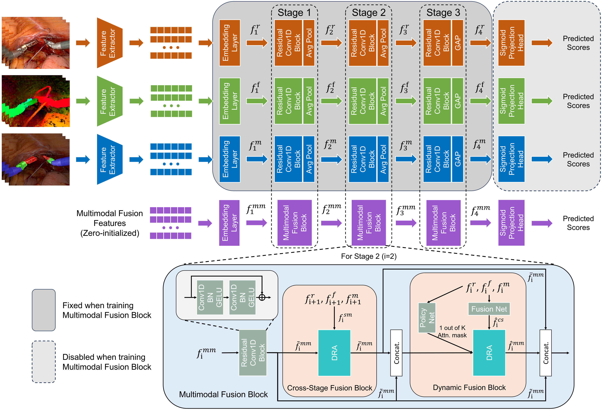

<div align="center">

<samp>
<h2> SurgFusion-Net: Diversified Adaptive Multimodal Fusion Network for Surgical Skill Assessment </h2>
</samp> 

| **[[```arXiv```](<https://arxiv.org/abs/2603.00108>)]** | **[[```Paper```](<https://ieeexplore.ieee.org/document/11647247>)]** |
|:-------------------:|:-------------------:|

</div> 

## SurgFusion-Net Architecture
<div align='center'>

</div>

## About RAH-skill and RARP-skill Datasets
The RAH-skill Dataset consists of 37 videos of the vaginal vault closure phase from Robot-assisted Hysterectomy (RAH) cases collected at University College London Hospital and Yeovil Hospital under ethical approval and patient consent (IRAS ID: 309024). Each video corresponds to a single patient case. Videos were recorded at 30 Hz and stored in “.mp4” format. Each video was segmented into three phases: right angle securement, middle section closure, and left angle securement. Non-suturing frames were removed, and each phase was scored using the [M-GEARS](https://pubmed.ncbi.nlm.nih.gov/39106003/) tool. Final scores represent the mean of the two raters, yielding 110 M-GEARS scores ranging from 14 to 30 across all phases.

The RARP-skill dataset contains 33 videos, a subset of the open-source [SAR-RARP50](https://arxiv.org/abs/2401.00496) dataset, of dorsal venous complex ligation from Robot-Assisted Radical Prostatectomy (RARP) collected at University College Hospital (Westmoreland Street, London, UK). Each video corresponds to a single patient case. Videos were recorded at 60 Hz and stored in “.avi” format. Based on video quality, 33 videos were selected for annotation. This yielded 33 M-GEARS scores ranging from 18 to 28.

## How to use the RAH-skill dataset
Please download surgical videos from the [RAH-40](https://drive.google.com/file/d/1jGPPTtMNSlKxIExL8o0MVoMstr9T5dxQ/view?usp=sharing) dataset (about 16.5 GB).The M-GEARS scores are provided in [RAH-40-MGEARS.xlsx](https://github.com/HRL-Mike/SurgFusion-Net/blob/main/labels/RAH-40-MGEARS.xlsx) under the labels folder. We divided each RAH video into three parts; the frame ranges for each part are provided in [RAH-40_part_frame_ranges.csv](https://github.com/HRL-Mike/SurgFusion-Net/blob/main/splits/RAH-40_part_frame_ranges.csv) under the splits folder. The 4-fold cross-validation splits are provided in the splits/RAH-4-fold folder.

## How to use the RARP-skill dataset
Please download surgical videos from the [SAR-RARP50](https://rdr.ucl.ac.uk/projects/SAR-RARP50_Segmentation_of_surgical_instrumentation_and_Action_Recognition_on_Robot-Assisted_Radical_Prostatectomy_Challenge/191091) dataset, including both the training and test sets. The M-GEARS scores are provided in [RARP-33-MGEARS.xlsx](https://github.com/HRL-Mike/SurgFusion-Net/blob/main/labels/RARP-33-MGEARS.xlsx) under the labels folder. The 4-fold cross-validation splits are provided in the splits/RARP-4-fold folder.


## Training Command:
TODO

## Acknowledgement
The implementation of SurgFusion-Net relies on resources from <a href="https://github.com/huggingface/transformers">Huggingface Transformers</a>, <a href="https://github.com/rwightman/pytorch-image-models/tree/master/timm">timm</a> and [MAQA](https://arxiv.org/abs/2402.09444). We thank the original authors for their open-sourcing.

## Citation
If you use the data and code for your research, please cite our paper.
```bibtex
@article{he2026surgfusion,
  title={SurgFusion-Net: Diversified Adaptive Multimodal Fusion Network for Surgical Skill Assessment},
  author={He, Runlong and Tesfai, Freweini M. and Boal, Matthew W. E. and Sirajudeen, Nazir and Anastasiou, Dimitrios and Xu, Jialang and Hoque, Mobarak I. and Edwards, Philip J. and Kelly, John D. and Sridhar, Ashwin and Kadkhodamohammadi, Abdolrahim and Chandrasekaran, Dhivya and Clarkson, Matthew J. and Stoyanov, Danail and Francis, Nader and Mazomenos, Evangelos B.},
  journal={IEEE Transactions on Medical Imaging},
  year={2026},
  publisher={IEEE},
  doi={10.1109/TMI.2026.3722251},
  note={Early Access}
}
```
